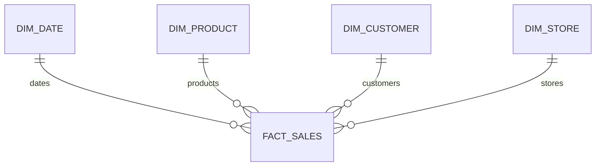

# Database Design

The demo is a star schema with grain **one fact row per order item**. `total_amount = quantity × unit_price − discount_amount`; revenue is additive. Distinct order count is semi-additive and must use `COUNT(DISTINCT order_id)`.

Surrogate integer dimension keys and a bigint fact key are primary keys. `(order_id, order_item_id)` prevents duplicate facts. Foreign keys enforce referential integrity; date/category/region and all foreign keys are indexed. The same logical model exists in both provider schemas.
